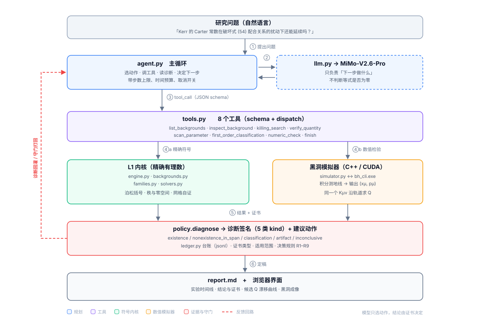

# 测地流二次守恒量的研究 Agent




---

## 0. 摘要

给一个度规 $g$，问：**它的测地流有没有二次守恒量？如果有，能不能写出来？破坏对称性的扰动之后它还在不在？**

这三个问题分别对应：**存在性**、**显式形式**、**稳定性**。本项目把三者都做成了可自动执行的流程：

| 层次 | 数学内容 
|---|---|
| 二维模型 | 共形平坦度规的可分离性判据 |
| 四维时空 | Schwarzschild / Kerr 的 Killing 张量与 Carter 常数 |
| 扰动稳定性 | 一阶延续方程 $\{Q_1,H_0\}+\{Q_0,H_1\}=0$ 的核空间分类 |
| 数值互证 | 沿真实测地线监测候选 $Q$ 的漂移 |

---

## 1. 问题

### 1.1 从 Killing 向量到 Killing 张量

Killing 向量场满足 $\mathcal L_Xg=0$ ，沿测地线有

$$
\frac{d}{ds}g(X,v)
=g(\nabla_vX,v)
=\tfrac12(\mathcal L_Xg)(v,v)
=0.
$$

因此 $g(X,v)$ 是一个关于速度的线性守恒量。令动量 $p_\mu=g_{\mu\nu}v^\nu$，它也可以写成 $p_\mu X^\mu$。

把这个构造推广到一个对称的 $(0,2)$ 型张量 $K$。沿测地线考察 $K(v,v)$，同样利用 $\nabla_vv=0$，得到

$$
\frac{d}{ds}K(v,v)
=(\nabla_vK)(v,v)
=\nabla_{(\lambda}K_{\mu\nu)}\,v^\lambda v^\mu v^\nu.
$$

任一点的任意切向量都能作为一条局部测地线的初速度，所以要求 $K(v,v)$ 沿所有测地线守恒，就等于要求右边的三次多项式对所有 $v$ 恒为零。它的系数给出 **Killing 张量方程**

$$
\nabla_{(\lambda}K_{\mu\nu)}=0.
$$

类似地在余切丛 $T^*M$ 上，用度量把速度换成动量后，测地流是 Hamiltonian

$$
H(x,p)=\tfrac12 g^{\mu\nu}(x)p_\mu p_\nu
$$

生成的 Hamilton 流。将 $K$ 的两个指标升起，得到二次量 $Q=K^{\mu\nu}(x)p_\mu p_\nu$。沿流有 $dQ/ds=\{Q,H\}$，于是

$$
\{Q,H\}\equiv 0
\quad\Longleftrightarrow\quad
\nabla_{(\lambda}K_{\mu\nu)}=0.
$$

这里的恒等式在整个相空间上成立。比如，取 $K=g$ 就得到 $Q=2H$，所以每个度量都自带一个二次守恒量。

**程序如何利用这个等价关系？** 在局部坐标中，泊松括号为

$$
\{Q,H\}=\sum_\lambda
\left(
\frac{\partial Q}{\partial x^\lambda}\frac{\partial H}{\partial p_\lambda}
-\frac{\partial Q}{\partial p_\lambda}\frac{\partial H}{\partial x^\lambda}
\right).
$$

对位置求导保持动量次数，对动量求导降低一次。由于 $H$ 和 $Q$ 都是二次齐次的，括号就是动量的三次齐次多项式。在四维，它至多有 $\binom{6}{3}=20$ 个动量单项式。固定 $g$ 后，逐项令系数恒为零，就得到关于 $K$ 的分量及其一阶导数的线性偏微分方程组。**选定有限候选空间以后**，例如把 $K$ 的分量写成若干指定坐标函数的线性组合，未知量才变成有限个常数。再把坐标函数的恒等式转成系数条件，就能用矩阵求核。

### 1.2 问题的意义

- **可积性**。二维情形下，测地流可积 $\iff$ 存在二次守恒量（Liouville）。四维里 Carter 常数的存在使 Kerr 测地线方程分离变量，这是黑洞吸积盘、阴影计算、引力透镜能算得动的前提。
- **隐藏对称性。** 一般的四维度规没有 Killing 张量，但是 Kerr 度规有。扰动分析研究这是巧合还是特殊的结构？
- **有现成的判据可以检验**。Vigeland–Yunes–Stein 的「bumpy black hole」工作给出了保持 Carter 常数的度量扰动所必须满足的配合关系（式 (54)）。**我们的任务是把它变成可自动检验、可分类的命题。**
其中该论文的式(54)系统性地分析了在$(t,r,\theta,\phi)$坐标系下，一个平稳、轴对称的度量$g_\varepsilon=g_{\mathrm{Kerr}}+\varepsilon h+O(\varepsilon^2).$如何保持平稳和轴对称地扰动度量，以及四种扰动分别对$h$的影响。

### 1.3 三个层次

**① 存在性。** 固定度量和有限候选空间 $V$，将守恒条件写成齐次系统 $Ac=0$。核空间 $\ker A$ 对应 $V$ 中的全部解。若 $W_{\mathrm{known}}\subseteq\ker A$ 是落在候选空间内的已知二次守恒量所张成的空间，则

$$
\mathrm{gap}=\dim\ker A-\dim W_{\mathrm{known}}
$$

度量的是商空间 $\ker A/W_{\mathrm{known}}$ 的维数。若 $\mathrm{gap}>0$，就可以提取出超出已知线性张成空间的解。若研究目标是可积性，还需检验所得守恒量与已有积分的**函数独立性**。

**② 显式形式。** 将核空间的基向量代回候选表达式，就能得到具体的 $Q(x,p)$。有了公式，可以检验它能否由已知守恒量组合出来，也可以观察它是否来自某种可分离结构。例如，若多个径向扰动 $f(r)=r^{-k}$ 都给出同样形式的修正，下一步就可以把 $f$ 保留为任意光滑函数，检查泊松括号中含 $f$ 和 $f'$ 的项是否分别抵消。这样能把若干个算例提升为一个适用于整族扰动的恒等式。

**③ 扰动稳定性。** 设

$$
\begin{aligned}
g_\varepsilon &= g_0+\varepsilon h+O(\varepsilon^2),\\
H_\varepsilon &= H_0+\varepsilon H_1+O(\varepsilon^2),\\
Q_\varepsilon &= Q_0+\varepsilon Q_1+O(\varepsilon^2).
\end{aligned}
$$

这里 $h$ 扰动的是度量，而 $H_\varepsilon$ 由**逆度量**决定。对逆矩阵求导可得

$$
H_1=-\tfrac12\bigl(g_0^{-1}h\,g_0^{-1}\bigr)^{\mu\nu}p_\mu p_\nu.
$$

已知 $\{Q_0,H_0\}=0$，将 $\{Q_\varepsilon,H_\varepsilon\}$ 的一阶项置零，得到

$$
\{Q_1,H_0\}+\{Q_0,H_1\}=0.
$$

这个方程问的是，能否选取 $Q_1$，恰好抵消度量变化给原守恒量 $Q_0$ 带来的一阶变化。

给定一个扰动 $h$，这是关于 $Q_1$ 的非齐次线性方程。若让 $h$ 和 $Q_1$ 分别在指定的有限空间内变化，程序就可以求联合系统的核，再将核投影到 $h$ 的参数空间。投影得到的正是**在所选候选空间中允许 $Q_0$ 一阶延续的扰动方向**。对某个方向求解失败时，结论的范围也由这一步确定，即该方向在本次选定的 $Q_1$ 空间内无解。

---

## 2. 研究结果

以下来自仓库内的程序，可用 `selftest.py` 复现。

### 二维共形平坦模型

先从一个可以直接看出可分离性的二维例子开始。取度量

$$
g_\varepsilon=(1+x^2+2y^2+\varepsilon x^2y^2)(dx^2+dy^2).
$$

在含 18 个未知系数的候选空间里，计算结果如下。

| $\varepsilon$ | 方程数 | 矩阵秩 | 解空间维数 | 已知解张成空间的维数 | gap |
|---|---:|---:|---:|---:|---:|
| $0$ | 40 | 16 | 2 | 2 | 0 |
| $1$ | 64 | 17 | 1 | 1 | 0 |
| $-1/4$ | 64 | 17 | 1 | 1 | 0 |
| $2,\ 1/2,\ -1$ | — | 17 | 1 | 1 | 0 |

当 $\varepsilon=0$ 时，共形因子可以写成一个只依赖 $x$ 的函数与一个只依赖 $y$ 的函数之和。变量分离给出了第二个守恒量 $Q_0$，它与 $H$ 一起张成了候选空间里的解空间。加入 $\varepsilon x^2y^2$ 后，对表中每个非零的 $\varepsilon$，候选空间里的解都只有 $H$ 的常数倍。

### Kerr 背景

取 $M=1$。在 60 维的二次多项式候选空间中，矩阵的秩是 57，求出的三个解恰好是 $p_t^2$、$p_tp_\phi$ 和 $p_\phi^2$。它们都来自能量和轴向角动量的乘积。Carter 常数在所用坐标下的系数含有分母，超出了这组多项式基底的范围，因此单独作为已知守恒量验证。

### Kerr 扰动下的一阶分类

取 $M=1$、$a=1/2$。我们选了 16 个扰动方向，其中 4 个按式 (54) 同时修改相关的度量分量，另外 12 个各自只修改一个分量，用来考察打破这些配合关系会怎样。$Q_1$ 的候选空间共 138 维，包括 120 个一般基函数、16 个增广项，以及 $H_0$ 和背景 Carter 常数 $Q_C$。

用 30 个点构造的联合矩阵大小为 $600\times154$，核空间为 9 维。这里面有 5 维对应 $h=0$ 时仍可加到 $Q_1$ 上的齐次解，剩下 4 维对应允许的扰动方向，恰好由那 4 个按式 (54) 构造的方向张成。化简后的约束在另外 12 个参数上形成单位阵，因此这 12 个参数都必须为零，彼此组合也无法抵消。这一分类适用于本次选定的扰动空间和 $Q_1$ 候选空间。

计算时用了 30 个点，得到 12 维的核基向量，全部通过了全域符号回代。计算耗时约 125 秒。

### 径向剖面可以取任意函数

对式 (54) 中含径向函数 $f(r)$ 的这族扰动，我们先试了 $1$、$r^{-1}$、$r^{-2}$、$r^{-3}$、$M^2r/(r^2+M^2)$、$M^2(r-M)^2/(r^2+M^2)^2$ 和 $e^{-r/M}$。这些例子都给出了同一个修正公式。于是把 $f$ 保留为抽象函数，再做一次符号验证。

结果是，取

$$
Q_1=-2a^2u^2H_1,\qquad u=\cos\theta,
$$

一阶泊松括号展开后的 20 个动量单项式系数全部恒为零。因此，对这族扰动，只要 $f(r)$ 在所考察的区域内光滑，同一个公式就能给出一阶修正。前面几个例子中的抵消由这族扰动的共同结构决定，与选用哪种具体剖面无关。

### 用数值轨道交叉检查

最后，把符号计算得到的同一个 $K^{\mu\nu}$ 交给黑洞模拟器，沿数值积分得到的测地线计算 $Q=K^{\mu\nu}p_\mu p_\nu$。这次积分中，$Q$ 的相对漂移约为 $4.7\times10^{-10}$。沿同一条轨道，与模拟器内置的 Carter 常数相比，两种计算方式的相对差约为 $9.3\times10^{-16}$，接近双精度浮点运算的舍入量级。

---

## 3. Agent 功能

Agent 作为一个**调度器**，可以将研究问题翻译成一串确定性实验，读回诊断结果，决定下一步，最后在守门通过后提交带证书的结论。

它能自己完成：

| 能力 | 表现 |
|---|---|
| **搜索** | 在有限候选空间内精确求 Killing 张量，报秩、零空间、`gap` |
| **验证** | 对任意给定的 $Q$ 做精确泊松括号回代，指出第一个非零系数在哪 |
| **扫参数** | 找 nullity 跳变的分岔点（例如 $\varepsilon$ 从 0 变到非 0） |
| **扰动分类** | 解一阶延续方程，逐方向判 ALLOWED / EXCLUDED，给出约束矩阵 |
| **数值互证** | 调黑洞模拟器积分测地线，用同一个 $K^{\mu\nu}$ 算漂移曲线 |
| **自我纠错** | 网格不足时自动加密到自证为止；结论越界时被策略层打回重写 |

具体计算交由已编写的Python程序运行， Agent 能够与其通信。

---

## 4. 黑洞模拟器

配套的桌面软件 **Black Hole Simulator**（C++20 / Qt6 / OpenGL / CUDA，见 [`软件/`](../../软件/)）是一个"黑洞周围天体运动与光传播的交互式三维实验室"：

- **物理内核**：Kerr-Schild 笛卡尔坐标下的 Kerr 度规（视界处无坐标奇性），解析导数，Dormand–Prince 5(4) 自适应积分，事件检测（捕获 / 逃逸 / 超时）
- **轨迹**：测试粒子与光子的类时 / 零测地线，倾斜轨道，参考系拖曳导致的轨道面进动
- **成像**：CUDA 反向零测地线追踪，背景星场 + 薄吸积盘 + 多普勒/红移因子，黑洞阴影与引力透镜
- **守恒量监测**：$E$、$L_z$、Carter $Q$、$2H$ 的漂移曲线
- **8 个预设场景**：圆轨道、进动、逃逸、捕获、Kerr 倾斜轨道、光线偏折、平行光束、阴影

---

## 5. Agent 架构分析

### 5.1 为什么要分成这四层

**LLM擅长决定"下一步该问什么"，但复杂计算可靠性与效率较低。**

所以把系统切开：

```
L1 内核      纯确定性：SymPy 精确运算
接口层       工具契约：JSON schema + dispatch，LLM由此与程序通信
L2 策略      诊断签名 + 决策规则 + 守门：分析算结果输出可决策的内容
L3 交互      主循环 / 台账 / 报告 / 界面
```

分层的收益是可替换：内核换成别的 CAS 不影响上层；模型换一个不影响内核；界面换成别的框架不影响后端。

### 5.2 流程图


（矢量图，源码见 [`文档/agent架构.svg`](../../文档/agent架构.svg)，可直接改文字。）

一次完整的回合是这样的：

1. **①** 用户用自然语言提出问题
2. **②** `agent.py` 把问题 + 工具清单交给模型，模型返回一个 `tool_call`
3. **③** `tools.py` 按 JSON schema 校验参数后派发
4. **④a** 符号路径：内核做精确有理数线性代数 / 符号恒等式
   **④b** 数值路径：`simulator.py` 调 `bh_cli.exe` 积分测地线，用**同一个** $K^{\mu\nu}$ 求 $Q$
5. **⑤** `policy.diagnose` 把原始结果压成诊断签名（`kind` + `reason` + `advice`），`ledger` 记录
6. **⑥** 诊断签名反馈给模型，它据此决定下一步；模型调 `finish` 时守门检查证据与措辞，不通过就打回重写

### 5.3 诊断签名：分析算结果输出可决策的内容

工具返回的kind：

| `kind` | 含义 | 建议动作 |
|---|---|---|
| `existence` | 找到了超出已知不变量的解 / 数值上守恒 | 独立回代，检查背景是否退化 |
| `nonexistence_in_span` | 声明的候选空间内没有额外解 | 扩基、换基底、扫参数 |
| `classification` | 分类结论（允许/排除） | 报告约束矩阵与允许子空间 |
| `artifact` | 网格伪解（残差形如 $\prod(r-r_i)$） | 加密网格重算 |
| `inconclusive` | 证据不足 | 补实验或降低结论强度 |

关键在于 **`gap = nullity − known_dim`**。只报 nullity 会把"对称性变大"误判成新发现——例如 Kerr 在 $a=0$ ，即 Schwarzschild 时，会多出退化的 $L^2$，但不是新的物理量。


---

## 6. 使用范例

### 6.1 环境

```powershell
python -m pip install sympy
$env:PYTHONUTF8 = "1"
$env:MIMO_API_KEY = "sk-..."
```

### 6.2 例一：二维模型，$\varepsilon$ 扰动

```powershell
cd 程序\agent
python cli.py ask "二维模型 g=(1+x^2+2y^2+eps*x^2*y^2)(dx^2+dy^2)：eps=0 时的第二个二次守恒量，在 eps 非零之后还存在吗？" --max-steps 8
```

模型自己走完了：`list_backgrounds` → `inspect_background`（$\varepsilon=0,1$）→ `killing_search`（秩 16/17）→ `verify_quantity`（确认 $Q_0$ 在 $\varepsilon=1$ 下不守恒，首个非零系数在 $p_y^3$）→ `scan_parameter`（分岔点 $\varepsilon=1$）→ `finish`。

生成的报告节选：

```
### 仅在有限候选空间内成立
- conformal2d（epsilon=0）在 degree=2、18 个未知系数的候选空间内：
  秩 16，解空间 2 维，其中已知不变量 2 维，gap=0。
  适用范围：18 维候选空间，epsilon=0，系数次数 ≤ 2　证据：#4
- Q 在 conformal2d（epsilon=1）下不守恒：
  {Q,H} 在动量幂 [0, 3] 处非零。　证据：#9
```

### 6.3 例二：Kerr 一阶分类

```powershell
python cli.py ask "Kerr 的 Carter 常数，在破坏 Vigeland-Yunes-Stein 式(54)配合关系的度量扰动下，还能不能延续为一阶守恒量？请分类：哪些扰动方向允许延续、哪些被排除。固定 M=1, a=1/2。"
```

模型自主设计了**正负对照**：先跑 `family="components"`（24 个破坏方向全排除，负对照），再跑 `family="eq54"`（4/4 允许，正对照），最后下结论。

```
| # | 工具                      | 诊断            | 判定 | 耗时   |
| 3 | killing_search            | 解空间 3 维…    | none…| 6.3s   |
| 4 | first_order_classification| 24 方向全排除   | none…| 21.5s  |
| 5 | first_order_classification| 4/4 可延续      | class| 117.6s |
```

直接跑单步（不需要 LLM）：

```powershell
python cli.py tool first_order_classification '{\"background\":\"kerr\",\"q0\":\"Q_C\",\"family\":\"eq54+components\",\"parameters\":{\"M\":\"1\",\"a\":\"1/2\"}}'
```

### 6.4 例三：符号 + 数值互证

```powershell
python cli.py ask "Kerr 背景 M=1, a=0.9：Carter 常数是否真的守恒？请同时用符号恒等式和数值轨道两种方式验证，并给出漂移量。"
```

模型的回答（节选）：

> 符号验证：$\{Q_C,H\}\equiv 0$（精确有理数消去，残差为 0）。
> 数值验证：沿一条真实测地线（$r_0=9$，$\theta=62°$）在 746 个采样点上相对漂移 $4.98\times10^{-9}$。
> **漂移量与积分误差一致，而非真实不守恒**：同一轨道上 Hamiltonian 的弥散为 $5.90\times10^{-10}$，模拟器内置 Carter 常数的相对漂移为 $3.91\times10^{-9}$，同量级。
> 综合判定：$Q_C$ 确实守恒。两条独立证据一致。

它自己把漂移和能量误差做了量级对比——这一步不是提示词教的，是 `numeric_check` 返回的诊断里同时给了两个漂移量。

---

## 7. 参考

- Vigeland, Yunes, Stein, *Bumpy Black Holes in Alternative Theories of Gravity* — 式 (54) 配合关系的来源（[`参考文献/`](../../参考文献/)）
- Carter, *Global structure of the Kerr family of gravitational fields* — Carter 常数
- Kruglikov & Matveev, *Normal forms for pseudo-Riemannian 2-dimensional metrics whose geodesic flows admit integrals quadratic in momenta* — 二维判据
- Bateman et al., *Regular black hole metric with three constants of motion* — 高阶推广

---

## 许可

课程研究项目。第三方论文与翻译仅作学习参考，版权归原作者。
