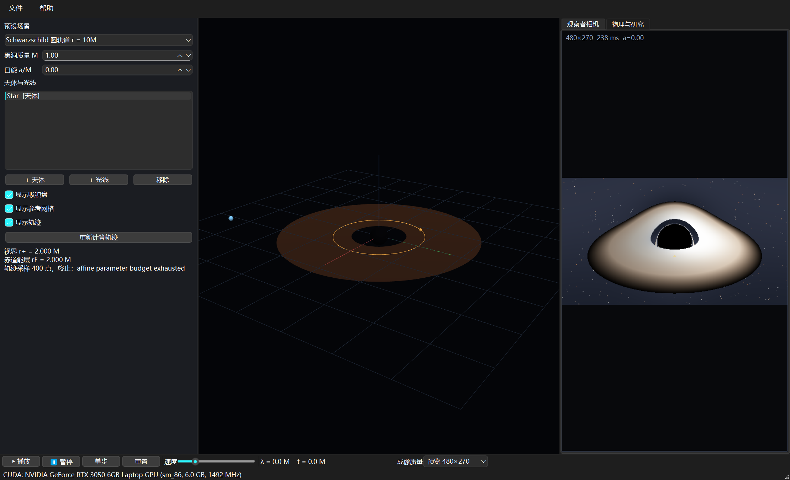
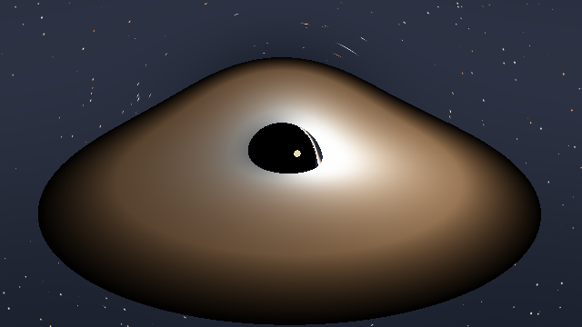
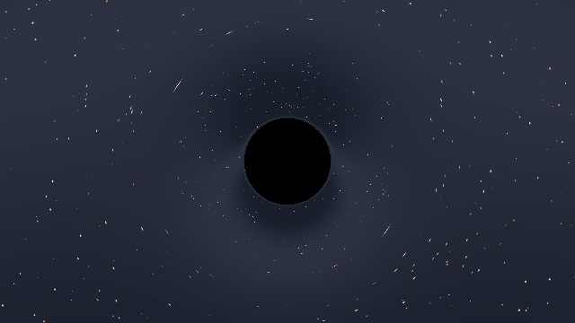

# Black Hole Simulator

**黑洞周围天体运动与光传播的交互式三维实验室** · Windows x64 · v0.1.0

在固定的广义相对论背景中模拟测试天体与光线的运动，提供三维轨迹演示和观察者成像，
并为守恒量验证预留了接入接口。它是本项目的可执行交付版本：把"Killing 张量搜索"得到的
候选守恒量放到真实轨道上检验，是这套软件最终要承担的角色。

## 下载与安装

**[⬇ 下载 BlackHoleSimulator_Setup.exe](https://github.com/Delta-Y123/Research-Agent-for-Quadratic-Conserved-Quantities-of-Geodesic-Flows/releases/latest)**

| 方式 | 操作 |
| --- | --- |
| 安装版 | 双击 `BlackHoleSimulator_Setup.exe` → 安装 → 从开始菜单或桌面快捷方式启动 |
| 命令行渲染 | `bh_cli.exe --preset shadow --width 800 --height 450 --out a.png` |

**系统要求**：Windows x64。观察者成像需要 NVIDIA 显卡（CUDA）；没有可用 GPU 时自动退化为
CPU 渲染，三维轨迹播放与守恒量监测不受影响。

## 界面

左侧「场景设置」改参数，中间「三维轨迹视图」看轨道，右侧标签页切换「观察者相机」与
「物理与研究」。底部是播放条与 CUDA 设备信息。

## 主要功能

**8 个预设场景**

| 预设 | 应该看到 |
| --- | --- |
| Schwarzschild 圆轨道 r = 10M | 闭合圆轨道，$E$、$L_z$ 恒定 |
| Schwarzschild 椭圆轨道 | 近星点逐圈进动 |
| Schwarzschild 逃逸 / 捕获 | 飞出计算区域 / 穿过视界终止 |
| Kerr 倾斜轨道 a = 0.9 | 轨道面被参考系拖曳进动 |
| 光线偏折 b = 5M、平行光束 | 不同碰撞参数偏折不同 |
| 黑洞阴影 a = 0.9 | 阴影 + 薄盘 + 透镜星场 |

**三维轨迹视图**：鼠标旋转缩放，显示视界、能层、吸积盘、各天体轨迹与相机标记。

**观察者相机**：每个像素反向追踪一条零测地线——落入视界就是黑的，逃到远处采样背景星场，
穿过薄盘按温度与红移着色。**阴影的边界是算出来的，不是画上去的圆。**

| | |
| --- | --- |
|  |  |
| Kerr 阴影与透镜化薄盘（a = 0.9） | 阴影与透镜星场 |

**物理与研究面板**：实时显示选中天体的 $E=-p_t$、$L_z$、Carter $Q$ 与 $2H$，
并绘制它们相对 $\lambda$ 的归一化漂移曲线。曲线整体平移或单调漂移说明是数值误差，
突然跳变则提示事件处理或初条件有问题。

**其他**：场景 JSON 存取、轨迹 CSV 导出（`lambda,t,x,y,z,E,Lz,Q,2H`）、图像 PNG 导出。

## 与本仓库研究的关系

软件的研究面板以

$$Q(x,p)=K^{\mu\nu}(x)\,p_\mu p_\nu$$

为接口形式，规划中的能力包括：导入候选 $Q$、检查 $\{Q,H\}$ 的符号残差、沿轨道监测漂移、
比较原背景与扰动背景、比较不同修正阶数、批量改变初始条件寻找反例。

**当前状态**：守恒量监测与导出已实现；**候选守恒量导入尚未实现**，接口已预留。
它正是为对接本仓库第二、第三阶段的成果而留的口子——把符号搜索得到的 $K^{\mu\nu}$
放进这里，就能同时看到"符号验证通过"与"数值轨道上确实不漂移"两条相互独立的证据。

需要强调的是，这三类结论不能互相替代：

- 符号恒等式验证通过 → 确认守恒关系；
- 数值轨道出现显著漂移 → 可以否定候选或定位错误；
- 有限条轨道上近似不变 → **不能**单独证明存在 Killing 张量。

## 物理约定

| 项目 | 约定 |
| --- | --- |
| 单位 | $G=c=1$，长度与时间以 $M$ 为单位 |
| 号差 | $(-,+,+,+)$ |
| 坐标 | Kerr-Schild 笛卡尔 $(t,x,y,z)$，视界处无坐标奇性 |
| 粒子 | $H=\tfrac12 g^{\mu\nu}p_\mu p_\nu$，$2H=-m^2$ |
| 光子 | $H=0$ |
| CPU 积分 | Dormand–Prince 5(4) 自适应，`rtol = 1e-9` |
| GPU 积分 | 四阶 Runge–Kutta，$h\approx0.03(1+r)$，FP32 |
| 吸积盘 | 几何薄盘，$T\propto r^{-3/4}$，含红移与多普勒因子 |

## 验证

内置 20 项物理验收测试全部通过，其中包括：$g^{\mu\nu}g_{\nu\lambda}=\delta$
（$a=0/0.5/0.9$，误差 $2\times10^{-16}$）、解析导数与中心差分一致（$9\times10^{-11}$）、
Schwarzschild 圆轨道 $r=10M$、Kerr 倾斜轨道的 Carter 常数守恒（相对漂移 $4\times10^{-11}$）、
光子球 $r=3M$、临界碰撞参数 $b_c=3\sqrt3\,M$、弱场偏折。

## 已知限制

- GPU 光线追踪为 FP32 + 固定步长，精度低于 CPU 轨迹；**定量结论请以 CPU 结果与守恒量漂移为准**
- 三维视图中的曲面与轨迹是坐标表示，不是等距嵌入
- 吸积盘为几何薄盘示意，不是辐射转移计算
- 相机不能进入 $1.35\,r_+$ 以内；成像是单帧快照，没有运动模糊
- 双黑洞、带电粒子、偏振平行移动、Maxwell 波动模块均未实现

## 文档

- [用户手册](USER_GUIDE.md)：全部界面、操作、快捷键与常见问题
- [发布页](https://github.com/Delta-Y123/Research-Agent-for-Quadratic-Conserved-Quantities-of-Geodesic-Flows/releases/latest)
